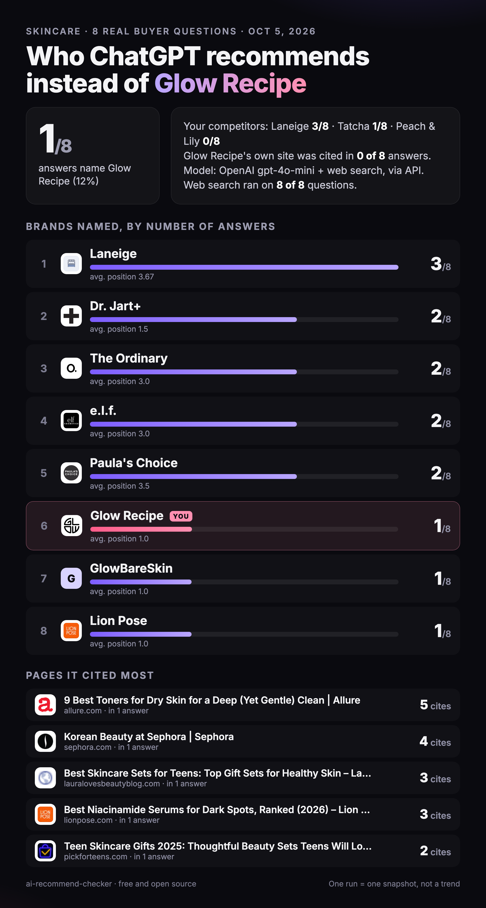

# ai-recommend-checker

**Who does ChatGPT recommend instead of you?**

Ask 5 to 10 real buyer questions to an OpenAI model with live web search. Get back a PNG card: which brands it named (and in what order), how often it named you, and the pages it cited most.



*Example: Glow Recipe, 8 skincare buyer questions, October 5, 2026, gpt-4o-mini with web search. One run is a snapshot, not a trend.*

## What you need

- Python 3.9+ (standard library only for the calls)
- **Bring your own OpenAI API key** (`OPENAI_API_KEY`). Each question is one Responses API call with the `web_search` tool, billed to your account.
- Optional: `pip install playwright && playwright install chromium` to export the card as PNG (otherwise you get the HTML)
- Optional: [Claude Code](https://claude.com/claude-code), to run it as a skill and let Claude write the questions and spot the other brands

## Install as a Claude Code skill

```bash
git clone <this repo> ~/.claude/skills/ai-recommend-checker
```

Then in Claude Code: *"who does ChatGPT recommend instead of glowrecipe.com?"* Claude asks for what's missing (category, 3 competitors, buyer questions), runs the check and shows you the card.

## Or run it by hand

```bash
export OPENAI_API_KEY=sk-...
cp examples/glow-recipe.json configs/my-brand.json   # edit brand, competitors, questions
python3 checker.py run configs/my-brand.json --backend openai
python3 checker.py card runs/my-brand-<date>
open runs/my-brand-<date>/card.png
```

Without Claude, the card counts your brand and your 3 competitors. To include every other brand the model named, list them in `runs/<folder>/brands_found.json` (format in `SKILL.md`) and run `card` again.

### Backends

| Backend | Env vars | Default model | Notes |
|---|---|---|---|
| `openai` | `OPENAI_API_KEY` | `gpt-5.5` | Responses API + `web_search` tool. Change with `--model`. |
| `dataforseo` | `DATAFORSEO_LOGIN`, `DATAFORSEO_PASSWORD` | `gpt-4o-mini` | ChatGPT LLM Responses endpoint. Sends `force_web_search: true`, otherwise answers often come back without web search. |

The run prints `web_search=True/False` and the cost for each question. Our Glow Recipe run on DataForSEO cost about $0.03 per question.

## Config

```json
{
  "brand": {"name": "Glow Recipe", "domain": "glowrecipe.com"},
  "category": "skincare",
  "country": "US",
  "competitors": [
    {"name": "Tatcha", "domain": "tatcha.com"},
    {"name": "Peach & Lily", "domain": "peachandlily.com", "aliases": ["Peach and Lily"]},
    {"name": "Laneige", "domain": "laneige.com"}
  ],
  "questions": ["Which moisturizer gives a glowy finish without feeling greasy?", "..."]
}
```

Write questions the way a buyer types them, before they know you. Never put your own brand name in a question.

## How it counts

- **Named** = the brand name appears in the answer text. Citation link titles are removed first (a "Tatcha Water Cream, Sephora" link is a page title, not a recommendation).
- A brand typed in the question itself ("cheaper alternative to Tatcha") does not count for that answer.
- **Position** = order of first appearance among the brands found in that answer.
- **Pages** = cited URLs, tracking parameters removed, ranked by answers then citations.

Everything is saved: `raw/qNN.json` (untouched API responses), `answers.json`, `results.json`, `card.html`, `card.png`.

## Honest limits

- An API answer is close to what the ChatGPT app shows, not identical (the app adds memory, location and its own model routing).
- One run is one snapshot. Answers move day to day: run it again before calling anything a trend.
- One engine only. Gemini, Perplexity and Google AI Overviews often name different brands and cite different pages.
- 8 questions is a sample, not your whole market.

## Want this tracked over time?

This script is a one-off photo. [Howseen](https://howseen.ai) tracks your real buyer questions on ChatGPT, Gemini, Perplexity, Google AI Overviews and AI Mode every week, shows the sources the models read, and turns it into an action plan.

## License

MIT
